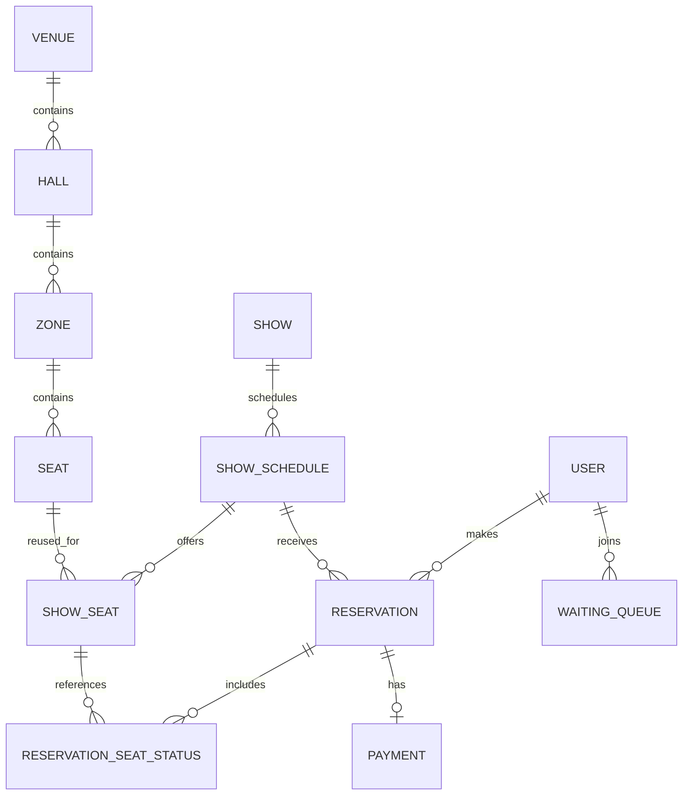

> Original Korean design: [ERD](https://tyge-ottesen-brahe.tistory.com/31). This is a **proposed schema**, not a verified production schema. Column names, types, statuses, and constraints below come from the planning document unless labeled as editorial review.

## 1. Physical venue structure

I first separated the physical layout of a venue from the individual performances taking place there. This allows one venue and its seats to be reused across multiple show schedules.

### `VENUE`

Stores a venue's identity and details.

| Column | Proposed type / constraint | Meaning |
|---|---|---|
| `ID` | `INT`, primary key, auto-increment | Venue ID |
| `NAME` | `VARCHAR(50)`, required | Venue name |
| `IMAGE_URL` | `VARCHAR(100)`, required | Image location |
| `DETAIL` | `VARCHAR(1000)`, nullable | Description |
| `ADDRESS` | `VARCHAR(100)`, required | Address |
| `TYPE` | `ENUM('CONCERT','SPORTS','MUSICAL')`, required | Venue category |
| `STATUS` | `ENUM('VALID','INVALID')`, default `VALID` | Active flag |
| `CREATED_AT`, `UPDATED_AT` | `DATETIME`, managed timestamps | Audit dates |

The original design specifies a unique constraint on `(ADDRESS, NAME)`. One venue may have multiple halls and multiple scheduled performances.

### `HALL`

Columns: `ID` (PK), `VENUE_ID` (FK, required), `NAME` (`VARCHAR(50)`, required), `IMAGE_URL` (`VARCHAR(100)`, required), `DETAIL` (`VARCHAR(500)`, optional), `STATUS`, `CREATED_AT`, and `UPDATED_AT`. A proposed unique constraint on `(VENUE_ID, NAME)` prevents duplicate hall names within one venue. One hall contains multiple zones and hosts scheduled performances.

### `ZONE`

Columns: `ID` (PK), `HALL_ID` (FK, required), `NAME` (`VARCHAR(30)`, required), `IMAGE_URL`, `STATUS`, and timestamps. `(HALL_ID, NAME)` is intended to be unique. A zone groups physical seats within a hall.

### `SEAT`

Columns: `ID` (PK), `ZONE_ID` (FK, required), `SEAT_NUMBER` (`SMALLINT`, required), `ROW_NUMBER` and `COL_NUMBER` (`SMALLINT`, default 0), `STATUS`, and timestamps. The design lists unique constraints for `(ZONE_ID, SEAT_NUMBER)` and `(ZONE_ID, ROW_NUMBER, COL_NUMBER)` so each seat has a stable identity and location.

## 2. Shows and scheduled seats

### `SHOW`

Represents the performance itself rather than a particular time slot. Columns: `ID`, `NAME` (`VARCHAR(100)`), `IMAGE_URL`, `DETAIL` (`VARCHAR(1000)`), `START_DATE`, `END_DATE`, and timestamps. The proposal uses `(NAME, START_DATE, END_DATE)` as a unique key. One show has multiple schedules.

### `SHOW_SCHEDULE`

Columns: `ID`, `SHOW_ID`, `VENUE_ID`, `HALL_ID` (foreign keys), `SHOW_DATE` (`DATE`), `SHOW_TIME` (`TIME`), `TICKETING_AT` (`DATETIME`), `DETAIL`, `STATUS` (`WAITING`, `RUNNING`, `FINISHED`), and timestamps. The original unique key is `(SHOW_ID, SHOW_DATE, SHOW_TIME)`.

### `SHOW_SEAT`

This entity connects a scheduled performance with a physical seat and its selling conditions. Fields: `ID`, `SHOW_SCHEDULE_ID`, `ZONE_ID`, `SEAT_ID`, `SEAT_NUMBER`, `PRICE` (`DECIMAL(10,2)`), `TYPE` (`BASIC`, `INVISUAL`, `DISABLE` in the original proposal), `STATUS` (`ON_SALE`, `RESERVATION`, `SOLD_OUT`), and timestamps. The proposed unique key is `(SHOW_SCHEDULE_ID, ZONE_ID, SEAT_ID)`.

The key distinction is that a physical seat persists, while its **availability and price may differ for each performance schedule**.

## 3. Reservations, booking states, and payments

### `RESERVATION`

Columns: `ID`, `USER_ID`, `SHOW_ID`, `SHOW_SCHEDULE_ID`, `STATUS` (`PENDING`, `CONFIRMED`, `CANCELLED`), and timestamps. The proposal deliberately permits multiple reservations by the same user for a show. One reservation can contain multiple selected seats.

### `RESERVATION_SEAT_STATUS`

Columns: `ID`, `RESERVATION_ID`, `SHOW_SEAT_ID`, `STATUS` (`LOCKED`, `BOOKED`), `LOCK_UNTIL`, and timestamps. This table was intended to track a reservation's temporary seat holds and confirmed seats.

### `PAYMENT`

Columns: `ID`, `USER_ID`, `RESERVATION_ID`, `AMOUNT` (`DECIMAL(10,2)`), `TRANSACTION_ID`, `PAID_AT`, `STATUS` (`PENDING`, `FAILED`, `SUCCESS`), and timestamps. The original proposal defines uniqueness on `(USER_ID, RESERVATION_ID)`, representing one payment record per user's reservation. The design uses simulated payment in the prototype.

## 4. Waiting queue and users

### `WAITING_QUEUE`

Columns: `ID`, `USER_ID`, `SHOW_ID`, `POSITION`, `TOKEN`, `ENQUEUED_AT` (spelled `ENQUED_AT` in the draft), `STATUS` (`CONNECT`, `DISCONNECT`), and timestamps. `(USER_ID, SHOW_ID)` is proposed as a unique key. The queue tracks a user's admission status for a performance.

### `USER`

Columns: `ID`, `ACCOUNT_ID` (`VARCHAR(20)`), `PASSWORD` (`VARCHAR(255)`), `ROLE` (`CUSTOMER`, `ADMIN`), `NAME`, `PHONE_NUMBER`, `ADDRESS`, `EMAIL`, `EMAIL_VERIFIED` (`Y`, `N`), `STATUS` (`ACTIVE`, `DORMANT`, `WITHDRAW`), and timestamps. The original proposal specifies unique constraints for account ID, email, and phone number.

The `PASSWORD` column must contain a strong salted password hash, **not a plaintext password**.

## Relationship overview

## Editorial integrity review

The schema is useful as a record of early design thinking, but several constraints need another iteration before implementation:

- A strict one-to-one relation between `SHOW_SEAT` and reservation-seat history conflicts with cancellations and repeat reservations. Historical rows should be distinguished from the current active booking.
- The availability transition must be safe under concurrent requests, backed by a database constraint or transaction protocol in addition to Redis holds.
- `SHOW_SEAT` redundantly references `ZONE_ID`, which is derivable from `SEAT_ID`; consistency must be enforced if retained.
- `SHOW_SCHEDULE` carries both `VENUE_ID` and `HALL_ID`; those foreign keys must refer to the same actual venue.
- `LOCK_UNTIL` in the original draft described a next-day release in one comment, while the functional specification proposes a five-minute TTL. Those rules must be reconciled.
- `DECIMAIL`, `DATENIME`, and `ENQUED_AT` are spelling errors in the original schema documentation, not database types to copy into an implementation.

This model helped me see why reservation systems require more than a seat-status flag: identity, scheduling, concurrency, and durable state transitions all interact.